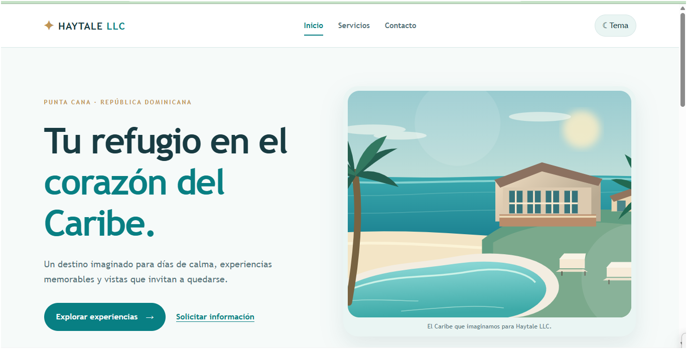
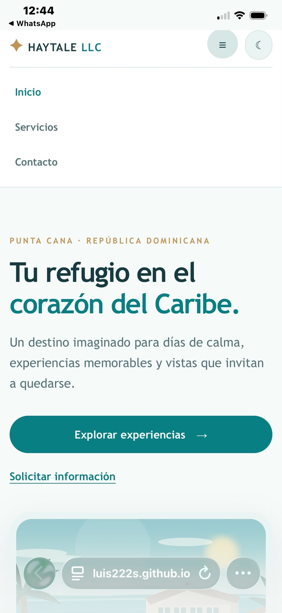
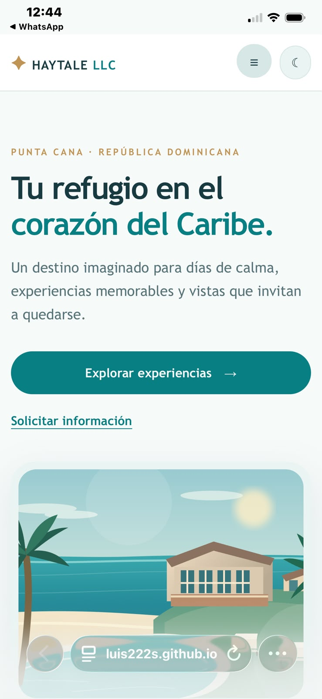
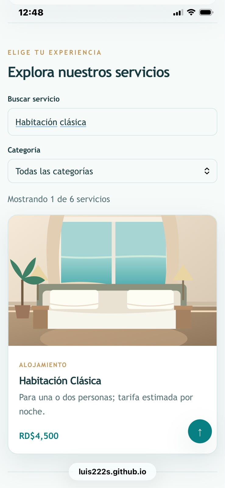
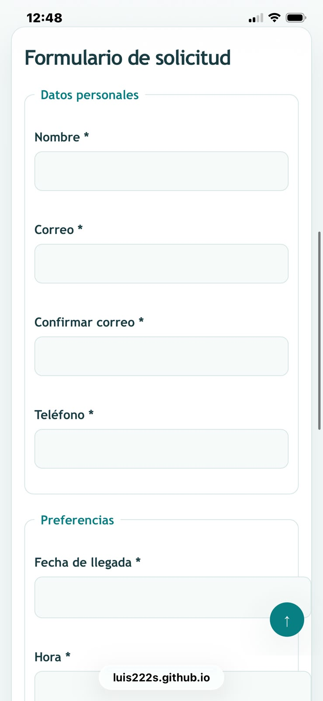

# Haytale LLC — Punta Cana

Sitio académico de un hotel conceptual en Punta Cana, República Dominicana. Esta segunda etapa incorpora un diseño **Caribe Premium** con CSS3 adaptable y comportamiento con JavaScript puro. Los servicios, precios, contactos y solicitudes son simulaciones educativas: el hotel no recibe reservas reales.

**Sitio publicado:** https://luis222s.github.io/haytale-llc/

**Repositorio:** https://github.com/Luis222s/haytale-llc

**Autor:** Luis Aquino · Matrícula 2023-0685

## Capturas

Capturas auténticas de la web publicada, realizadas en un navegador de escritorio y en un iPhone. Las imágenes del teléfono muestran distintas partes de las páginas al desplazarse.

**Portada de escritorio**



**Portada en móvil y menú desplegado**





**Catálogo filtrado y formulario en móvil**





Capturas adicionales de los contenidos de las tres páginas en [`docs/capturas/`](docs/capturas/).

**Documentación técnica:** [Descargar PDF](docs/documentacion.pdf) (7 páginas, elaborado a partir de la rúbrica de la práctica).

## Mapa de etiquetas: nueve familias

| Familia | Página y sección | Etiquetas usadas | ¿Por qué esa etiqueta? |
| --- | --- | --- | --- |
| Cimientos | Las tres, documento | `DOCTYPE`, `html`, `head`, `meta`, `title`, `body` | Identifican documento, idioma y adaptación a cada pantalla. |
| Semántica | Todas, estructura; contacto, datos | `header`, `nav`, `main`, `section`, `article`, `aside`, `footer`, `time`, `address`, `details`, `summary` | Dan significado a cada región sin depender de su aspecto. |
| Texto | Inicio, servicios, contacto | `strong`, `em`, `mark`, `abbr`, `small`, `code`, `kbd`, `pre` | Diferencian énfasis, abreviaturas y ejemplos. |
| Citas | Inicio y servicios | `blockquote`, `cite`, `q` | Distinguen frases citadas y citas completas. |
| Listas | Inicio y servicios | `ul`, `ol`, `li`, `dl`, `dt`, `dd` | Organizan experiencias, pasos y definiciones hoteleras. |
| Enlaces | Todas, navegación y datos | `a`, `mailto:`, `tel:`, `#id`, `download`, `target`, `rel` | Permiten navegar, contactar, consultar fuentes y descargar. |
| Multimedia | Inicio y servicios | `img`, `figure`, `figcaption`, `iframe`, `audio`, `source` | Presentan imágenes, mapa y sonido ambiental. |
| Tabla | Servicios, tarifas | `table`, `caption`, `thead`, `tbody`, `tfoot`, `th`, `td`, `rowspan`, `colspan` | Comparan seis servicios y sus tarifas estimadas. |
| Formulario | Contacto, solicitud | `form`, `fieldset`, `legend`, `label`, `input`, `select`, `optgroup`, `textarea`, `button` | Recogen datos de ejemplo con campos asociados y validaciones. |

## Funcionalidades de JavaScript

| Funcionalidad | Página | Evento | Función principal |
| --- | --- | --- | --- |
| Menú hamburguesa accesible | Las tres | `click` | `classList.toggle()` y actualización de `aria-expanded` |
| Modo oscuro persistente | Las tres | `click` | `actualizarBotonTema()`, `localStorage` |
| Año automático | Las tres | Carga | `new Date().getFullYear()` |
| Volver arriba | Las tres | `scroll`, `click` | `actualizarArriba()` |
| Seis tarjetas | Servicios | Carga | `pintarTarjetas()` |
| Búsqueda y categorías | Servicios | `input`, `change` | `filtrarServicios()` con `filter()` |
| Precios en DOP | Servicios | Renderizado | `toLocaleString("es-DO", …)` |
| Validación bajo los campos | Contacto | `submit`, `input`, `blur` | `validarCampo()`, `mostrarError()` |
| Confirmación local y limpieza | Contacto | `submit` | Listener de `#solicitud`, `reset()` |

### Reglas propias del formulario

- Teléfono de diez dígitos con prefijo 809, 829 u 849 (se admite `+1` opcional).
- Fecha de llegada no anterior a hoy.
- Confirmación de correo idéntica al correo principal.
- Máximo dos huéspedes en habitación Clásica.

## Estructura

```text
index.html
servicios.html
contacto.html
css/estilos.css
js/app.js
img/                   ilustraciones SVG optimizadas
assets/                audio ambiental
docs/                  PDF y capturas finales
README.md
```

## Cómo ejecutarlo

Abrir `index.html` con Live Server o visitar el sitio publicado. El formulario no envía ni almacena datos en un servidor.

## Revisión de entrega

- Validación oficial realizada el 11 de noviembre de 2026: tres páginas HTML5 sin errores y hoja CSS3 sin errores (siete advertencias informativas sobre variables CSS).
- Sitio publicado en GitHub Pages; se comprobaron las tres rutas, el menú, el modo oscuro, los filtros y la validación del formulario.
- Capturas reales de escritorio y móvil incorporadas a `docs/capturas/`.
- Documento técnico de siete páginas en `docs/documentacion.pdf`. La guía específica del docente no fue facilitada; este documento sigue la rúbrica disponible.
- Comprobar nuevamente el diseño a 360 px y el campo de fecha en Safari después de publicar este último ajuste.
- Mantener al menos diez commits con mensajes descriptivos.
